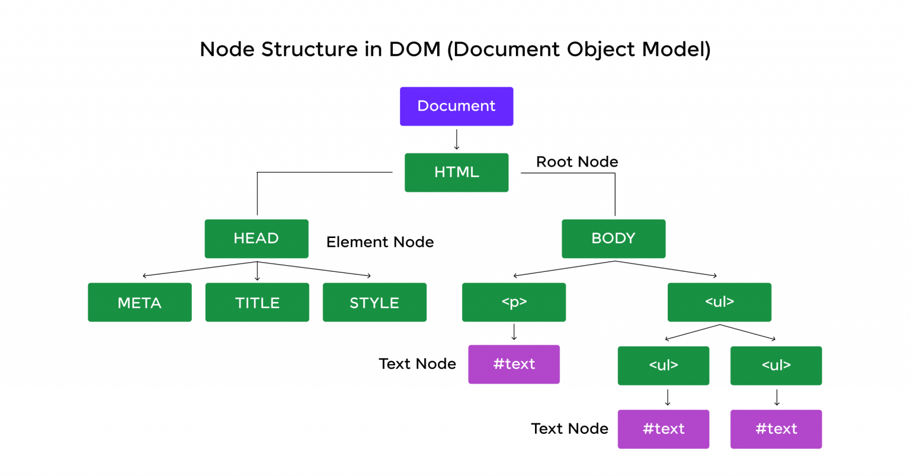

# DOM

### **1. DOM là gì?**

- **DOM (Document Object Model)**: Là một giao diện lập trình (API) biểu diễn tài liệu HTML/XML dưới dạng cây cấu trúc phân cấp. Nó cho phép các ngôn ngữ như JavaScript truy cập, thay đổi nội dung, cấu trúc, và định dạng của trang web động.
- **Đặc điểm**:
     - DOM được tạo ra khi trình duyệt tải trang web, gọi là **DOM Tree**.
     - DOM là "live": Thay đổi trên DOM sẽ cập nhật trực tiếp lên giao diện người dùng.
     - Độc lập với ngôn ngữ: Có thể tương tác với DOM bằng JavaScript, Python, v.v.

---

### **2. Cấu trúc DOM (DOM Tree)**

DOM được tổ chức như một cây phân cấp với các **node** (nút) có quan hệ cha-con:



---

### **3. Các thành phần của DOM (DOM Nodes)**

Mọi thứ trong DOM đều là **node**, chia thành các loại chính:

#### **a. Node Types**

| Loại Node          | Giá trị `nodeType` | Ví dụ                  |
| ------------------ | ------------------ | ---------------------- |
| **Element Node**   | `1`                | `<div>`, `<p>`, `<a>`  |
| **Text Node**      | `3`                | Văn bản trong thẻ HTML |
| **Comment Node**   | `8`                | `<!-- Comment -->`     |
| **Document Node**  | `9`                | Đối tượng `document`   |
| **Attribute Node** | `2`                | `class="container"`    |
| ...                |                    |                        |

#### **b. Đặc điểm của Node**

- Mỗi node có các **thuộc tính** cơ bản:
     - `nodeName`: Tên node (ví dụ: `DIV`, `#text` cho text node).
     - `nodeValue`: Giá trị node (ví dụ: nội dung text node).
     - `nodeType`: Loại node (như bảng trên).
- **Quan hệ giữa các node**:
     - `parentNode`: Node cha.
     - `childNodes`: Danh sách node con.
     - `firstChild`/`lastChild`: Node con đầu/cuối.
     - `nextSibling`/`previousSibling`: Node liền kề.

---

### **4. Phân loại chi tiết các Node**

#### **a. Element Node**

- Đại diện cho thẻ HTML (ví dụ: `<div>`, `<span>`).
- **Thuộc tính**:
     - `id`, `className`, `style`, `attributes`.
- **Phương thức**:
     - `querySelector()`, `appendChild()`, `remove()`, `setAttribute()`.

#### **b. Text Node**

- Chứa văn bản trong thẻ HTML.
- Ví dụ: `document.createTextNode("Hello")`.

#### **c. Attribute Node**

- Đại diện cho thuộc tính của thẻ HTML (ví dụ: `href`, `src`).
- Truy cập qua `element.attributes` hoặc `getAttribute()`.

#### **d. Document Node**

- Node gốc (`document`), là cổng kết nối vào DOM.

---

### **5. Ví dụ minh họa**

#### **Truy cập và thay đổi DOM bằng JavaScript**

```javascript
// Truy cập phần tử
const div = document.querySelector("div");

// Thêm node con
const newParagraph = document.createElement("p");
newParagraph.textContent = "New Paragraph";
div.appendChild(newParagraph);

// Sửa đổi thuộc tính
div.setAttribute("class", "container");

// Xóa node
const oldText = div.firstChild;
div.removeChild(oldText);
```

---

### **6. Lưu ý quan trọng**

- **DOM ≠ HTML**: DOM được tạo từ HTML nhưng có thể thay đổi động.
- **Khác biệt giữa `children` và `childNodes`**:
     - `children`: Chỉ trả về **Element Nodes**.
     - `childNodes`: Trả về mọi node (text, comment, element).
- **Hiệu suất**: Thao tác DOM nhiều gây tốn tài nguyên, nên tối ưu bằng `DocumentFragment`.

---

### **Kết luận**

DOM là nền tảng để tương tác với nội dung trang web. Hiểu rõ cấu trúc cây, các loại node, và cách thao tác với chúng giúp xây dựng ứng dụng web linh hoạt và mạnh mẽ.
