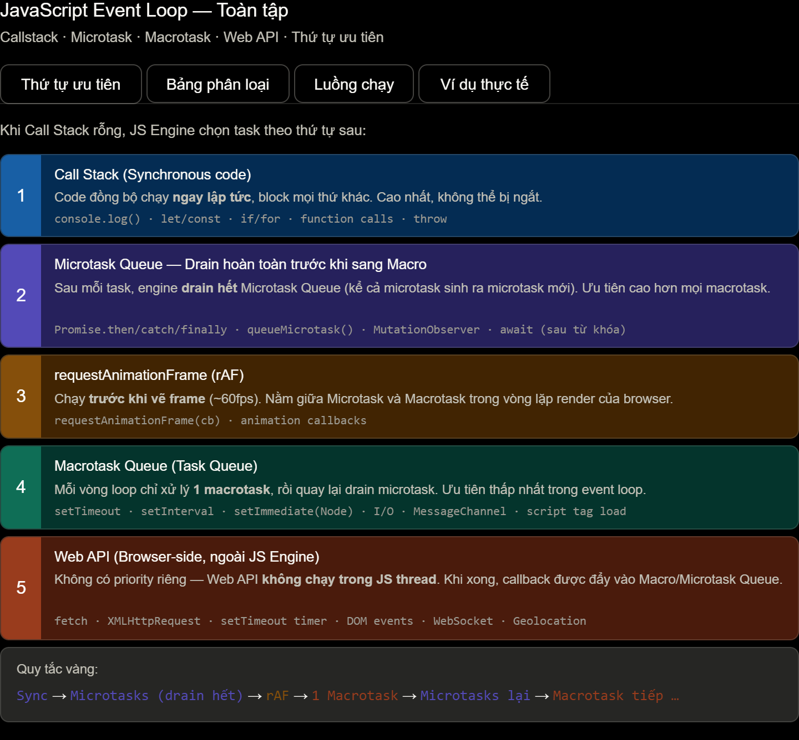

# Event Loop

## Event Loop

Dưới đây là **toàn bộ kiến thức về Event Loop trong JavaScript**, trình bày **đầy đủ – chi tiết – đúng thứ tự chạy**, theo mức **chuẩn phỏng vấn Frontend (React / Next.js)** và **đủ sâu cho dev 1.5–3 năm**.

---

# 1. Event Loop là gì? (Định nghĩa chuẩn)

**Event Loop** là **cơ chế của JavaScript runtime (Browser / Node.js)** giúp:

> 👉 JavaScript **xử lý các tác vụ bất đồng bộ** trong khi **bản thân JS là single-thread**.

Nói đơn giản:

- JS **chỉ chạy 1 việc tại 1 thời điểm**
- Nhưng Event Loop giúp JS **trông giống như chạy nhiều việc cùng lúc**

---

# 2. Vì sao JS cần Event Loop?

JavaScript:

- ❌ Không thể chạy song song nhiều dòng code
- ❌ Nếu chờ I/O (API, timer, file, DOM) → sẽ **block UI**

👉 Event Loop cho phép:

- Gửi các tác vụ tốn thời gian ra ngoài (Web APIs / libuv)
- Khi xong thì **đưa lại vào hàng đợi**
- JS **lấy ra chạy khi rảnh**

---

# 3. Tổng quan kiến trúc Event Loop (Browser)

```
Call Stack
   ↓
Web APIs (setTimeout, fetch, DOM events)
   ↓
Queues (Microtask / Macrotask)
   ↓
Event Loop
```

---

# 4. Call Stack (Quan trọng nhất)

**Call Stack**:

- Nơi JS **thực thi code**
- Chạy theo **LIFO** (Last In – First Out)

Ví dụ:

```js
function a() {
	b();
}

function b() {
	console.log("B");
}

a();
```

Call Stack:

```
a()
 └─ b()
     └─ console.log
```

➡ Chạy xong → pop ra

---

# 5. Web APIs là gì?

**Web APIs (Browser)**:

- setTimeout
- setInterval
- fetch / XMLHttpRequest
- DOM events
- MutationObserver

⚠️ **Không nằm trong JS Engine**
➡ Trình duyệt xử lý riêng

---

# 6. Task Queue (Macrotask Queue)

Còn gọi là **Callback Queue / Macrotask Queue**

Chứa:

- `setTimeout`
- `setInterval`
- DOM events (`click`, `scroll`)
- `setImmediate` (Node.js)

Ví dụ:

```js
setTimeout(() => {
	console.log("timeout");
}, 0);
```

➡ callback được đưa vào **Macrotask Queue**

---

# 7. Microtask Queue (Cực kỳ quan trọng)

**Microtask Queue có độ ưu tiên CAO HƠN Macrotask**

Chứa:

- `Promise.then / catch / finally`
- `queueMicrotask`
- `MutationObserver`

Ví dụ:

```js
Promise.resolve().then(() => {
	console.log("promise");
});
```

---

# 8. Thứ tự ưu tiên chuẩn (CỰC QUAN TRỌNG)

👉 **Event Loop chỉ làm 1 việc duy nhất:**

```
1. Thực thi Call Stack cho đến khi rỗng
2. Chạy TOÀN BỘ Microtask Queue
3. Lấy 1 Macrotask → đưa vào Call Stack
4. Lặp lại
```

📌 **Microtask luôn chạy hết trước khi chạy Macrotask tiếp theo**

---

# 9. Ví dụ tổng hợp kinh điển (PHẢI THUỘC)

```js
console.log("start");

setTimeout(() => {
	console.log("timeout");
}, 0);

Promise.resolve().then(() => {
	console.log("promise");
});

console.log("end");
```

### Thứ tự chạy:

1️⃣ `start` (Call Stack)
2️⃣ `end` (Call Stack)
3️⃣ `promise` (Microtask)
4️⃣ `timeout` (Macrotask)

👉 Output:

```
start
end
promise
timeout
```

---

# 10. Ví dụ nâng cao (Microtask lồng Microtask)

```js
console.log("A");

Promise.resolve().then(() => {
	console.log("B");
	Promise.resolve().then(() => {
		console.log("C");
	});
});

setTimeout(() => {
	console.log("D");
}, 0);

console.log("E");
```

### Thứ tự:

1. A
2. E
3. B
4. C
5. D

👉 **Microtask sinh thêm Microtask → vẫn chạy trước Macrotask**

---

# 11. Event Loop + fetch()

```js
console.log("1");

fetch("/api").then(() => {
	console.log("2");
});

setTimeout(() => {
	console.log("3");
}, 0);

console.log("4");
```

➡ `fetch.then` = **Microtask**

Output:

```
1
4
2
3
```

---

# 12. Node.js Event Loop (Nâng cao – phỏng vấn Senior)

Node.js có **nhiều phase**:

1. Timers (`setTimeout`)
2. I/O callbacks
3. Idle / Prepare
4. Poll
5. Check (`setImmediate`)
6. Close callbacks

⚠️ Nhưng:

- **Microtask (Promise)** vẫn chạy **giữa mỗi phase**

---

# 13. Vì sao `setTimeout(fn, 0)` không chạy ngay?

Vì:

- `0` ≠ chạy ngay
- Nó chỉ là **thời gian tối thiểu**
- Vẫn phải:
     - Chờ Call Stack rỗng
     - Chờ Microtask chạy xong

---

# 14. Event Loop trong React (rất hay hỏi)

- `setState` **không chạy ngay**
- React **batch update**
- Promise → có thể khiến render sớm hơn setTimeout

Ví dụ bug phổ biến:

```js
setCount(1);
console.log(count); // vẫn là giá trị cũ
```

➡ do **Event Loop + batching**

---

# 15. Những lỗi phổ biến khi không hiểu Event Loop

❌ Nghĩ `Promise` là async task giống `setTimeout`
❌ Nghĩ `await` là block code
❌ Không hiểu thứ tự log
❌ Debug React state sai

---

## Thứ tự ưu tiên



**Tab "Thứ tự ưu tiên"** — 5 tầng từ cao đến thấp, với quy tắc vàng: sync → microtask (drain hết) → rAF → macrotask (chỉ 1) → lặp lại.

**Tab "Bảng phân loại"** — toàn bộ ~35 phương thức được phân loại: sync, microtask, macrotask, Web API, async/await.

**Tab "Luồng chạy"** — sơ đồ mỗi tick của event loop, kèm 3 điểm khác biệt quan trọng nhất.

**Tab "Ví dụ thực tế"** — giải thích từng bước tại sao output lại là `1 → 6 → 3 → 4 → 2 → 5`.

**Điểm dễ nhầm nhất:** `setTimeout(fn, 0)` vẫn là macrotask — `Promise.then` luôn chạy trước nó dù `setTimeout` được khai báo trước trong code. Và `new Promise(executor)` — phần executor chạy **synchronous**, chỉ `.then()` mới là microtask.

---

## Ví dụ

```ts
// ─── SYNC ───────────────────────────────
console.log("[1] SYNC — bắt đầu script");

// ─── MACROTASK (delay = 0) ───────────────
setTimeout(() => console.log("[7] MACRO — setTimeout 0"), 0);

// ─── MICROTASK ───────────────────────────
Promise.resolve().then(() => {
	console.log("[4] MICRO — Promise.then");
	queueMicrotask(() => console.log("[5] MICRO — microtask sinh ra trong micro"));
});

// ─── WEB API + async/await ───────────────
async function fetchData() {
	console.log("[3] SYNC — bên trong async fn (trước await)");
	const res = await fetch("https://httpbin.org/get");
	const data = await res.json();
	console.log("[9] MICRO — sau fetch (Web API xong → await resume)");
}

// ─── requestAnimationFrame ───────────────
requestAnimationFrame(() => console.log("[6] rAF — trước khi vẽ frame"));

// ─── MACROTASK (delay = 300ms) ───────────
setTimeout(() => console.log("[8] MACRO — setTimeout 300ms"), 300);

// ─── SYNC ───────────────────────────────
fetchData();
console.log("[2] SYNC — kết thúc script");
```
